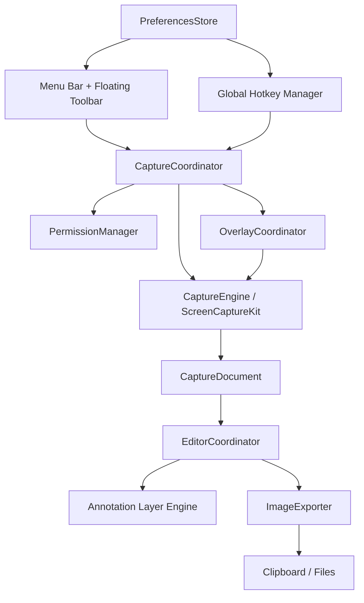
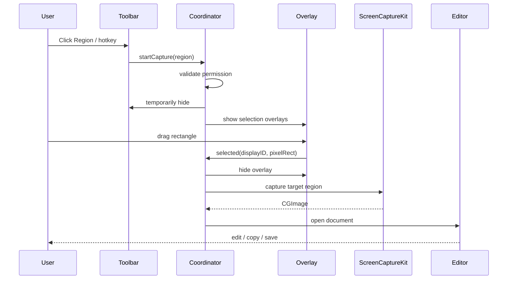

# MacCapture — Kế hoạch phát triển ứng dụng chụp màn hình native macOS

> **Phiên bản tài liệu:** 1.0  
> **Ngày:** 22/10/2026  
> **Trạng thái:** Implementation-ready plan  
> **Định hướng:** Ứng dụng toolbar nổi nhỏ gọn, lấy trải nghiệm thao tác của FastStone Capture làm tham khảo; tự xây dựng UI và mã nguồn, không sao chép tài sản thương mại.

---

## 1. Executive summary

**MacCapture** là ứng dụng chụp và chú thích ảnh màn hình trên macOS, hoạt động chủ yếu bằng một **floating toolbar luôn sẵn sàng** và biểu tượng trên menu bar. Tiêu chí hàng đầu: mở nhanh, chụp trong một thao tác, chỉnh sửa đơn giản nhưng hữu ích, copy/lưu nhanh, không có cửa sổ dashboard cồng kềnh.

**Đích MVP (v0.1):** mở ứng dụng → toolbar nổi xuất hiện → bấm Region / Window / Fullscreen → chụp → mở editor → thêm arrow / rectangle / text → Copy hoặc Save PNG. Hỗ trợ phím tắt và nhớ vị trí toolbar. Chưa làm scrolling capture hay recording trong MVP.

**Nền tảng:** Swift 6 (theo toolchain Xcode được chọn), SwiftUI + AppKit, ScreenCaptureKit, Core Graphics, ImageIO; macOS 14+ dự kiến, kiểm chứng các API và deployment target trong spike đầu tiên.

**Không thuộc phạm vi:** đồng bộ đám mây, tài khoản, backend, AI inference, quảng cáo, tự upload ảnh, tự gửi dữ liệu đến server.

## 2. Mục tiêu và tiêu chí thành công

### 2.1 Product goals

1. Toolbar nổi chiếm ít không gian, có thể di chuyển, ẩn/hiện và mở lại từ menu bar.
2. Capture vùng chọn, cửa sổ, toàn màn hình với độ nét Retina chuẩn.
3. Editor dạng layer, chú thích sửa được và hỗ trợ Undo/Redo.
4. Export PNG chuẩn, copy vào clipboard tương thích các app thông dụng.
5. Hoạt động offline, phân quyền minh bạch; không chụp bí mật khi chưa được cho phép.
6. Codebase chia module thuận lợi bổ sung OCR, scrolling capture và recording.

### 2.2 Non-goals cho MVP

- Không sao chép nguyên giao diện/icon hoặc branding FastStone.
- Không làm bộ dựng video, cloud sharing, browser extension.
- Không cam kết scrolling capture áp dụng cho tất cả ứng dụng.
- Không lấy ảnh màn hình làm telemetry.

### 2.3 Tiêu chí chấp nhận đo được (mục tiêu nội bộ)

| ID | Chỉ số | Ngưỡng mục tiêu | Cách kiểm tra |
|---|---|---|---|
| P-01 | Thời gian từ nhấn hotkey đến overlay sẵn sàng | p95 < 400 ms sau khi đã warm-up | 30 lần trên Mac test |
| P-02 | Thời gian chụp xong đến editor hiển thị | p95 < 1.5 s với vùng 1920×1080 | instrumentation |
| P-03 | Toolbar compact | cao 40–46 pt, rộng 320–390 pt | snapshot và manual QA |
| P-04 | Copy/Save | 100% ảnh smoke test mở được | clipboard/paste + Preview |
| P-05 | Multi-display | vùng chọn không lệch trên 2 màn hình khác scale | matrix manual QA |
| P-06 | Undo/Redo | 100% phép thêm/xóa/sửa annotation phục hồi đúng | unit tests |
| P-07 | Không upload dữ liệu | không có network request trong luồng capture/editor | kiểm tra network |

Các con số trên là **target cần đo**, không phải thông số đã được xác minh.

---

## 3. Người dùng và các tình huống chính

- **UC-01: Chụp vùng:** click Region/hotkey → toàn màn hình tối nhẹ → kéo chọn → release → editor.
- **UC-02: Chụp cửa sổ:** hover để highlight cửa sổ → click → editor; bỏ qua chính toolbar của ứng dụng.
- **UC-03: Toàn màn hình:** chọn display (nếu nhiều display) → capture → editor.
- **UC-04: Chú thích:** chọn Arrow → vẽ mũi tên → đổi màu/độ dày → Undo → Copy.
- **UC-05: Lưu nhanh:** chụp → Cmd+S → tên mặc định theo timestamp → chọn thư mục → PNG.
- **UC-06: Ẩn toolbar:** click X trên thanh nổi → chỉ ẩn panel, app vẫn chạy ở menu bar → Show Toolbar để bật lại.
- **UC-07: Không cấp quyền:** giải thích lý do, hướng dẫn mở System Settings và cho retry; không bắt app crash.

## 4. UI/UX specification — Floating Toolbar

### 4.1 Thiết kế mặc định

- Một dải nằm ngang dạng **compact bar** (không dùng title bar macOS truyền thống).
- Kích thước mục tiêu: **360 × 44 pt**; padding 6–8 pt; hit-area mỗi nút tối thiểu khoảng 32 × 32 pt; một số nút ít dùng nằm trong menu `…`.
- Material: nền NSVisualEffectView hoặc SwiftUI material qua AppKit, viền mờ, shadow nhẹ, bán kính bo 10–12 pt.
- Biểu tượng: **SF Symbols** nhất quán; tooltip hiển thị tên thao tác và shortcut.
- Phím tắt và menu phải tiếp cận được từ VoiceOver; trạng thái focus rõ ràng.
- Người dùng có thể **drag vùng trống** của toolbar để di chuyển; không cản click icon.
- Lưu **tọa độ tương đối với visibleFrame của màn hình** + screen identifier; khi thay đổi màn hình/độ phân giải phải clamp về vùng nhìn thấy.

### 4.2 Wireframe kích thước tương đối

```text
┌─────────────────────────────────────────────────────────────┐
│ ⋮⋮   ▧ Region   ▣ Window   ◻ Full   ⇵ Scroll*   ● Rec*   ⋯  × │
└─────────────────────────────────────────────────────────────┘
      drag         capture modes                      more  hide
```

Dấu `*`: tính năng hiển thị disabled với tooltip "Coming in v0.2/v0.3" hoặc ẩn khỏi thanh mặc định cho đến khi phát hành; **không để nút giả hoạt động**.

**Quyết định UI cho v0.1:** mặc định hiển thị: drag handle, Region, Window, Fullscreen, Delay dropdown, More, Hide. Scroll và Record nằm trong roadmap, không phải nút giả.

### 4.3 Hành vi chi tiết

| Thành phần | Click | Secondary interaction | Keyboard |
|---|---|---|---|
| Region | Bắt đầu chọn vùng | Tooltip | `⌃⌘1` (có thể đổi) |
| Window | Chọn một cửa sổ | Hover highlight | `⌃⌘2` |
| Fullscreen | Chụp màn hình đang chọn | Nếu nhiều display, hiện picker | `⌃⌘3` |
| Delay | Menu 0/3/5/10 giây | Ghi nhớ chọn | qua menu |
| More | Popover với Editor, Preferences, Hide, Quit | Menu bar mirror | — |
| Drag handle | Kéo panel | Double-click reset vị trí (nếu bật) | — |
| X | Ẩn panel (không quit) | — | — |

**Lưu ý shortcut:** macOS có shortcut có sẵn; cần phát hiện xung đột, cho phép đổi keybinding và cung cấp fallback menu bar. Combo nêu trên là giá trị khởi tạo dự kiến.

### 4.4 Chế độ hiển thị

- `alwaysOnTop`: mặc định bật, có tùy chọn tắt; `NSPanel` với level phù hợp.
- `showOnAllSpaces`: tùy chọn mặc định bật; kiểm thử fullscreen Spaces.
- `autoHide`: mặc định tắt; khi bật có thể thu lại thành handle ở cạnh màn hình, **không mất khả năng khôi phục**.
- `launchAtLogin`: mặc định tắt, sử dụng ServiceManagement theo API phù hợp.
- `theme`: System / Light / Dark.
- `scale`: Compact / Comfortable; đảm bảo Accessibility.

### 4.5 Overlay chọn vùng

- Khi kích hoạt, ẩn toolbar trước khi capture để tránh xuất hiện trong ảnh.
- Overlay trên **từng màn hình vật lý**, vùng phủ phù hợp coordinates của mỗi `NSScreen`.
- Toàn nền tối nhẹ; crosshair, hướng dẫn `Esc cancel`, label hiển thị `W × H px`.
- Drag chọn từ mọi hướng; clamp vào display. Release tạo vùng capture; vùng nhỏ hơn ngưỡng 4×4 px thì hủy/cho thử lại.
- `Esc`: cancel; cursor được phục hồi; overlay được gỡ sạch kể cả khi capture báo lỗi.
- Xử lý một cách nhất quán tọa độ: **AppKit points ↔ backing pixels ↔ CoreGraphics coordinate system**.
- Nếu nhiều display: MVP chỉ cho chọn vùng trong một màn hình mỗi lần; chụp vùng xuyên màn hình là mục tiêu về sau.

### 4.6 Window selection

- Lấy danh sách cửa sổ có thể chia sẻ bằng ScreenCaptureKit.
- Hover xác định candidate window; vẽ viền highlight nằm ngoài ảnh.
- Click chụp bằng content filter theo window ID, không chụp ảnh toàn màn hình rồi crop một cách tùy tiện (tránh lỗi cửa sổ bị che).
- Bỏ qua toolbar, overlay và cửa sổ helper của ứng dụng.
- Kiểm tra trường hợp cửa sổ protected, minimized, fullscreen, permission denied.

### 4.7 Menu bar

```text
MacCapture
  Capture Region
  Capture Window
  Capture Fullscreen
  Open Editor…
  ───────────────
  Show/Hide Floating Toolbar
  Recent Captures (optional v0.2)
  Preferences…
  About
  Quit
```

App chủ yếu là accessory app / menu bar agent (`LSUIElement` nếu phù hợp); editor vẫn phải có trải nghiệm cửa sổ, focus và Cmd+Tab hợp lý. Quyết định policy activation trong spike UX.

---

## 5. Annotation Editor specification

### 5.1 UI

```text
┌────────────────────────── MacCapture Editor ──────────────────────────┐
│  Undo Redo  | Select Arrow Rect Ellipse Text Crop | Blur*  Copy Save │
├───────────────────────────────────────────────────────────────────────┤
│                                                                       │
│                   ẢNH GỐC + ANNOTATION LAYERS                        │
│                                                                       │
├───────────────────────────────────────────────────────────────────────┤
│  Stroke color   Width   Font size   Zoom 100%    Size: 1440×900 px    │
└───────────────────────────────────────────────────────────────────────┘
```

### 5.2 Editor MVP

- Tool: Select, Arrow, Rectangle, Ellipse, Text, Crop.
- Mỗi annotation là một đối tượng: có id, kind, bounding box, style, z-index.
- Di chuyển, resize, thay đổi màu và độ dày nét; selection handles.
- Undo/Redo cho: add, delete, move, resize, update style, text edit, crop.
- Fit to window, zoom 50/100/200% và trackpad zoom.
- Cmd+C copy ảnh **đã flatten**, Cmd+S save PNG, Cmd+Shift+S Save As.
- Editor mở ảnh chụp vừa tạo, có thể mở PNG/JPEG từ file qua Open Editor.

### 5.3 Phase sau

- Blur/pixelate, numbered steps, highlighter, freehand, spotlight, padding/background, JPEG/WebP, import/export project chỉnh sửa được.
- **Không xem blur là cơ chế bảo mật tuyệt đối**; với redaction nhạy cảm cần thiết kế xóa/che thông tin không thể đảo ngược trên bản xuất.

### 5.4 Document model

```swift
struct CaptureDocument {
    let id: UUID
    let capturedAt: Date
    let imagePixelSize: CGSize
    let baseImage: CGImage
    var annotations: [Annotation]
    var cropRect: CGRect?
}

enum AnnotationKind: Codable {
    case arrow, rectangle, ellipse, text
}

struct Annotation: Identifiable, Codable {
    var id: UUID
    var kind: AnnotationKind
    var frame: CGRect
    var style: AnnotationStyle
    var text: String?
    var zIndex: Int
}
```

Đây là **model định hướng**, không khẳng định toàn bộ đoạn mã biên dịch nguyên trạng. Cân nhắc format persistence tránh encode trực tiếp `CGImage` bằng `Codable`.

---

## 6. Kiến trúc kỹ thuật



### 6.1 Modules

| Module | Trách nhiệm | Không được làm |
|---|---|---|
| `AppShell` | vòng đời app, menu bar, cửa sổ | xử lý raw pixel |
| `Toolbar` | NSPanel, vị trí, collapse, tooltip | gọi ScreenCaptureKit trực tiếp |
| `CaptureCoordinator` | state machine capture, cancel/error | vẽ chú thích |
| `CaptureEngine` | danh sách display/window, single frame capture | UI |
| `Overlay` | selection points và target IDs | ghi file |
| `Editor` | canvas, annotation, undo/redo | xin quyền screen capture |
| `Export` | flatten và encode PNG, clipboard | tạo UI |
| `Settings` | hotkeys, vị trí, preferences | giữ ảnh màn hình |
| `Permissions` | trạng thái và hướng dẫn cấp quyền | vượt qua kiểm soát hệ điều hành |

### 6.2 Dependency principles

- AppKit/SwiftUI được giữ ở lớp presentation; Core không phụ thuộc `NSPanel`.
- Define `CaptureEngineProtocol` và `ImageExporting` để test bằng mock.
- Chạy việc nặng ở async task/background thích hợp; mọi cập nhật UI trên MainActor.
- Không giữ nhiều full-resolution `CGImage` không cần thiết; kiểm soát vòng đời và peak memory.
- Tránh tạo service/backend khi chưa có use case.

### 6.3 State machine

```text
idle
  ├── requestCapture → checkingPermission
  │   ├── denied → permissionHelp → idle
  │   └── allowed → selectingRegion | selectingWindow | capturingFullscreen
  │                       ├── cancel → idle
  │                       └── selection → capturing
  │                                          ├── error → idle + notification
  │                                          └── success → editing
  └── openEditor → editing
editing → exported | discarded → idle
```

Bất kể lỗi/cancel nào đều phải gỡ overlay, phục hồi toolbar/cursor, và đưa hệ thống về trạng thái ổn định.

### 6.4 API/service interfaces

```swift
protocol CaptureEngineProtocol {
    func listDisplays() async throws -> [CaptureDisplay]
    func listWindows() async throws -> [CaptureWindow]
    func captureDisplay(id: UInt32) async throws -> CGImage
    func captureWindow(id: UInt32) async throws -> CGImage
    func captureRegion(displayID: UInt32, rectInPixels: CGRect) async throws -> CGImage
}

protocol ImageExporting {
    func pngData(image: CGImage) throws -> Data
    func savePNG(image: CGImage, to url: URL) throws
    func copyImage(image: CGImage) throws
}
```

`CaptureDisplay`, `CaptureWindow` sẽ bọc metadata, không lộ trực tiếp `SCDisplay` / `SCWindow` cho UI khi không cần.

### 6.5 macOS frameworks

- **ScreenCaptureKit**: enumeration và capture display/window/region; kiểm tra `SCScreenshotManager` theo deployment target.
- **AppKit**: `NSPanel`, overlay windows, mouse tracking, menu bar.
- **SwiftUI**: toolbar content, preferences, editor shell.
- **Core Graphics / ImageIO**: crop, render, PNG encode.
- **Vision**: OCR ở v0.2.
- **AVFoundation + ScreenCaptureKit**: recording ở v0.3.
- **ServiceManagement**: launch at login tùy chọn.
- **Accessibility APIs**: chỉ cân nhắc cho scrolling tự động và sau khi người dùng cấp quyền phù hợp.

Tài liệu tham khảo: [Apple ScreenCaptureKit](https://developer.apple.com/documentation/screencapturekit), [SCScreenshotManager](https://developer.apple.com/documentation/screencapturekit/scscreenshotmanager), [NSPanel](https://developer.apple.com/documentation/appkit/nspanel), [Apple macOS capture sample](https://developer.apple.com/documentation/screencapturekit/capturing-screen-content-in-macos).

---

## 7. Workflow và sequence

### 7.1 Region capture



### 7.2 Export

1. Snapshot document state, chọn cropRect.
2. Render base image và annotation theo đúng `zIndex` vào output bitmap ở **pixel resolution**.
3. Encode PNG bằng ImageIO; kiểm tra metadata không vô tình chứa dữ liệu không mong muốn.
4. Copy `NSPasteboard` hoặc gọi save panel với quyền filesystem phù hợp.
5. Hiển thị success/error feedback không chặn thao tác tiếp theo.

---

## 8. Quyền truy cập, privacy, security

- Giải thích rõ `Screen Recording` permission và chỉ yêu cầu khi cần capture; tôn trọng dialog của macOS.
- ScreenCaptureKit và thiết lập quyền được kiểm thử trên macOS 14/15/phiên bản máy phát triển; một số thay đổi hành vi theo OS.
- Accessibility permission **không cần cho MVP** nếu chỉ region/window/fullscreen capture thông thường.
- Không yêu cầu Microphone permission cho đến khi implement thu âm.
- Không lưu ảnh mặc định trừ khi user bấm Save hoặc bật setting auto-save.
- Clipboard chỉ chứa dữ liệu ảnh khi user chọn Copy; xem xét cảnh báo clipboard có thể được ứng dụng khác đọc.
- Không gửi telemetry chứa nội dung screenshot; crash logging (nếu thêm sau) phải loại bỏ pixel và đường dẫn nhạy cảm.
- Xử lý protected windows và màn hình DRM bằng thông báo phù hợp, không tìm cách bypass.
- Cấp quyền tối thiểu; review entitlement/signing/hardened runtime khi phát hành.

---

## 9. Performance / Retina / multi-display

- Logic tách **logical points** và **physical pixels**: rect selection trên `NSScreen` → convert chuẩn → capture/crop.
- Không giả định mọi display đều scale 2x; test 1x/2x/mixed scaling.
- Không giả định màn hình chính có origin `(0,0)`; test màn hình ở trái/phải/trên/dưới.
- Kiểm thử menubar, Dock, notch/safe area, Space fullscreen, Stage Manager.
- Toolbar position clamp vào `visibleFrame` khi unplug display.
- Không tự ý downsample ảnh để hiển thị nhanh mà làm giảm ảnh export; editor có thể render preview độ phân giải thấp nhưng export từ original.
- Quy định tiêu chí memory: theo dõi peak RSS khi xử lý ảnh 4K và undo stack; dùng command-based undo hoặc copy-on-write model tránh clone bitmap mỗi thao tác.

---

## 10. Kế hoạch scrolling capture (v0.2, nghiên cứu riêng)

### 10.1 Chiến lược theo cấp

1. **Controlled web content:** Nếu trang được render trong WebKit do ứng dụng kiểm soát, có thể xuất ảnh/nội dung toàn trang qua cơ chế phù hợp.
2. **Manual scroll stitching:** user tự cuộn, capture liên tiếp, ghép theo vùng overlap.
3. **Auto scroll:** điều khiển ứng dụng khác thông qua Accessibility nếu khả thi và user đồng ý; fallback manual nếu không kiểm soát được.

Không hứa hỗ trợ mọi app: sticky header, virtual scrolling, animation, lazy loading, nội dung video và cửa sổ protected có thể gây lỗi.

### 10.2 Stitch pipeline

`frame acquisition → crop fixed chrome → estimate vertical translation → confidence validation → seam selection/blending → append canvas → bottom detection → export`.

- MVP thử thuật toán overlap bằng normalized cross correlation / feature matching hoặc SSIM giữa strips.
- Dùng downscaled previews để estimate offset; ghép bản gốc theo pixel.
- Dừng khi trùng frame, hết cuộn, user cancel, timeout hoặc vượt giới hạn chiều cao/memory.
- Nếu confidence dưới ngưỡng: yêu cầu người dùng chỉnh alignment hoặc xuất từng frame; **không âm thầm ghép sai**.
- Test với Safari, Chrome, Finder và một app native khác; ghi rõ compatibility matrix.

### 10.3 Recording v0.3

- Mở recorder riêng với region/display/window, video format, FPS, cursor/microphone tùy chọn.
- Xử lý start/stop, quyền microphone, preview file, encoding, out-of-disk.
- Không trộn lifecycle recorder với screenshot coordinator; dùng `RecordingCoordinator` riêng.

---

## 11. Cấu trúc repository đề xuất

```text
MacCapture/
├── README.md
├── LICENSE
├── plan.md
├── CONTRIBUTING.md
├── docs/
│   ├── architecture.md
│   ├── ui-spec.md
│   ├── permission-guide.md
│   └── test-matrix.md
├── MacCapture.xcodeproj/
├── MacCapture/
│   ├── App/
│   │   ├── MacCaptureApp.swift
│   │   ├── AppDelegate.swift
│   │   ├── AppCoordinator.swift
│   │   └── MenuBarController.swift
│   ├── Features/
│   │   ├── Toolbar/
│   │   │   ├── FloatingToolbarPanel.swift
│   │   │   ├── ToolbarView.swift
│   │   │   ├── ToolbarViewModel.swift
│   │   │   └── ToolbarPositionStore.swift
│   │   ├── Capture/
│   │   │   ├── CaptureCoordinator.swift
│   │   │   ├── ScreenCaptureEngine.swift
│   │   │   ├── RegionOverlayController.swift
│   │   │   ├── WindowSelectionController.swift
│   │   │   └── CoordinateConverter.swift
│   │   ├── Editor/
│   │   │   ├── EditorWindowController.swift
│   │   │   ├── EditorView.swift
│   │   │   ├── AnnotationCanvas.swift
│   │   │   ├── AnnotationModels.swift
│   │   │   └── AnnotationCommandStack.swift
│   │   ├── Export/
│   │   │   ├── ImageRenderer.swift
│   │   │   ├── PNGExporter.swift
│   │   │   └── ClipboardService.swift
│   │   └── Settings/
│   │       ├── PreferencesView.swift
│   │       └── PreferencesStore.swift
│   ├── Core/
│   │   ├── HotkeyManager.swift
│   │   ├── PermissionManager.swift
│   │   └── CaptureTypes.swift
│   └── Resources/
├── MacCaptureTests/
│   ├── CoordinateConverterTests.swift
│   ├── CaptureCoordinatorTests.swift
│   ├── AnnotationCommandTests.swift
│   └── ExportTests.swift
└── MacCaptureUITests/
    ├── ToolbarUITests.swift
    └── EditorUITests.swift
```

---

## 12. Sprint backlog — thứ tự triển khai cụ thể

### Sprint 0 — Foundation / feasibility spike

**Deliverables:** project chạy được, app menu bar, proof-of-concept screenshot 1 màn hình.

- [ ] Kiểm tra Xcode/toolchain/deployment target và ScreenCaptureKit APIs.
- [ ] Tạo macOS app, cấu hình signing, capabilities, Info.plist privacy strings.
- [ ] Xác nhận app có thể hiển thị status item và mở editor window.
- [ ] Spike single-frame display screenshot, test permission denied/granted.
- [ ] Ghi lại API availability notes và giới hạn macOS version.

**Exit criteria:** click menu bar → chụp được ảnh test và copy vào clipboard; permission failure không crash.

### Sprint 1 — Floating toolbar

- [ ] Implement `FloatingToolbarPanel` (`NSPanel`, borderless/nonactivating khi thích hợp).
- [ ] Embed SwiftUI `ToolbarView` vào panel bằng hosting view.
- [ ] Layout compact, tooltip, hover/focus, light/dark.
- [ ] Drag handle và lưu vị trí theo display.
- [ ] Hide/show từ menu bar, giữ toolbar trên Spaces theo cấu hình.
- [ ] Settings: show toolbar on startup, always on top, toolbar scale.
- [ ] Unit/UI smoke tests cho persistence, clamp vị trí, hide/show.

**Exit criteria:** toolbar xuất hiện đúng khi launch, click/drag không gây vô tình capture, đổi màn hình vẫn nhìn thấy.

### Sprint 2 — Three capture modes

- [ ] `CaptureCoordinator` và state machine (idle/selecting/capturing/editing/error).
- [ ] Fullscreen target display và capture bằng ScreenCaptureKit.
- [ ] Region overlay, cancel bằng Escape, label dimensions.
- [ ] Window chooser/highlight và capture riêng window.
- [ ] Hide app windows trước capture, phục hồi khi cancel/error.
- [ ] Hotkey manager, shortcut conflict handling.
- [ ] Retina/multi-screen coordinate conversion tests.

**Exit criteria:** Region, Window, Fullscreen đều tạo đúng ảnh trên màn hình test; cancel sạch overlay.

### Sprint 3 — Editor + export

- [ ] `CaptureDocument` và annotation layer model.
- [ ] Canvas render preview và select/drag/resize objects.
- [ ] Arrow/Rectangle/Ellipse/Text/Crop.
- [ ] Undo/Redo command stack; keyboard shortcuts.
- [ ] Flatten high-resolution output và copy clipboard.
- [ ] Save PNG với `NSSavePanel` và đặt tên mặc định.
- [ ] Error feedback cho write denied/out of disk.

**Exit criteria:** end-to-end screenshot → arrow/text → Undo/Redo → Save/Copy, ảnh đúng resolution.

### Sprint 4 — QA, packaging và MVP release

- [ ] Snapshot UI ở Light/Dark, nhiều kích thước và VoiceOver smoke tests.
- [ ] Manual QA trên ít nhất 2 cấu hình display, permission test.
- [ ] Kiểm tra memory/performance, lỗi app không phản hồi, rò rỉ overlay.
- [ ] README, screenshots, changelog, license, build instructions.
- [ ] GitHub Actions build/test trên macOS runner theo Xcode có sẵn.
- [ ] Developer ID signing/notarization nếu phân phối bên ngoài môi trường phát triển; tạo DMG/ZIP.
- [ ] Tạo GitHub Release `v0.1.0` sau khi đạt release gates.

**Exit criteria:** một người dùng Mac khác có thể cài, cấp quyền, chụp, annotate, save mà không cần Xcode.

### Sprint 5 — v0.2: OCR + scrolling + annotation nâng cao

- [ ] OCR Vision → copy recognized text.
- [ ] Blur/pixelate và numbered steps.
- [ ] Manual scroll stitching có confidence threshold.
- [ ] Auto scrolling thử nghiệm với app compatibility matrix.
- [ ] Giới hạn memory, timeout, cancel của scroll job.

### Sprint 6 — v0.3: Recording

- [ ] Screen recording display/window/region.
- [ ] Start/stop + timer + indicator rõ ràng.
- [ ] Optional microphone sau khi xin quyền.
- [ ] File encoding/export và xử lý dung lượng.

---

## 13. Testing plan

### 13.1 Unit tests

- Coordinate converter: origin âm, scale 1x/2x, reverse drag, clamp.
- Document model: serialize annotation (nếu persist), ordering và z-index.
- Undo/Redo: add, remove, resize, style, text, crop.
- PNG output: đúng width/height, alpha/color behavior.
- Toolbar position: lưu/restore theo screen, missing display fallback.

### 13.2 Integration tests

- Mock permission states và engine failures.
- Test coordinator cleanup khi cancel/throw.
- Capture → render annotations → export image trong memory.
- Clipboard chứa dữ liệu ảnh hợp lệ sau Copy.

### 13.3 Manual QA matrix

| Scenario | Máy/môi trường | Expected |
|---|---|---|
| Screen permission denied | Fresh install | hướng dẫn cấp quyền, không crash |
| Retina + external monitor | mixed scale | region đúng vị trí và pixel size |
| External monitor disconnected | toolbar đặt ở display phụ | toolbar quay về display chính |
| Fullscreen app / Spaces | Safari, Finder | toolbar/overlay hoạt động theo thiết kế |
| Window over other windows | overlapping windows | capture đúng window được chọn |
| Escape during selection | region/window | cleanup overlay + toolbar restored |
| Clipboard paste | Preview/Pages/chat app | ảnh dán đúng |
| Save invalid destination | folder không ghi được | có error, ảnh vẫn giữ trong editor |
| Light/dark/large text | System settings | icon rõ, button bấm được |
| Multi-capture rapid sequence | 10 captures liên tiếp | không deadlock/race |

### 13.4 Release gates

- [ ] Tất cả acceptance criteria P-01…P-07 đã đo hoặc ghi lại ngoại lệ có lý do.
- [ ] Không có crash trong toàn bộ smoke scenarios.
- [ ] Không có lỗi dữ liệu xuất PNG/clipboard.
- [ ] Quyền màn hình được giải thích và xử lý an toàn.
- [ ] Ứng dụng đóng/mở toolbar rõ ràng, Quit kết thúc thật.
- [ ] Code build trên môi trường clean theo README.

---

## 14. CI/CD và phân phối

**CI khi push/PR:** SwiftFormat/SwiftLint (nếu chọn), `xcodebuild build`, unit tests, UI smoke tùy runner, upload test report/artifact. Pin Xcode version; cache dependencies vừa phải.

**Release:** tag semantic version → archive Release → ký Developer ID → notarize → staple ticket → đóng gói DMG/ZIP → publish GitHub Release + SHA256 checksum. Nếu chưa có Apple Developer Program, có thể build/run local nhưng **không tuyên bố binary được notarize**.

**Open-source:** đề xuất MIT hoặc Apache-2.0 (chọn một và kiểm tra dependency licenses); CONTRIBUTING, CODE_OF_CONDUCT và issue templates tối thiểu. Không sử dụng tên hay artwork FastStone trong branding.

---

## 15. Rủi ro và quyết định kiến trúc

| Rủi ro | Tác động | Mitigation |
|---|---|---|
| Permission thay đổi giữa phiên bản macOS | capture thất bại | Spike trước, test macOS versions, error state |
| AppKit points vs backing pixels | sai vùng chụp | centralized coordinate converter + tests |
| NSPanel behavior trong fullscreen/Spaces | toolbar biến mất hoặc khó focus | test panel levels/collection behaviors, fallback menu bar |
| Hotkeys đụng shortcut hệ thống | thao tác không chạy | custom bindings và conflict diagnostics |
| Screenshot chứa overlay của app | lỗi UX | hide/cleanup trước capture, test race |
| Editor giữ quá nhiều bitmap | memory cao | vector annotation layers, lazy rasterize |
| Scrolling ghép sai | dữ liệu ảnh sai | confidence, preview, cancel/fallback manual |
| Recording làm nặng app | scope creep | chỉ sau MVP, module riêng |

### Architectural Decision Records (ADR) cần ghi

- ADR-001: Native SwiftUI + AppKit thay Electron.
- ADR-002: Toolbar dùng `NSPanel`, menu bar làm entry/fallback.
- ADR-003: ScreenCaptureKit cho frame capture, tách adapter theo OS API.
- ADR-004: Editor lưu vector annotations, chỉ flatten khi export.
- ADR-005: MVP không backend/no telemetry.
- ADR-006: Scrolling capture được triển khai riêng sau core MVP.

---

## 16. Task breakdown theo issue để giao cho AI coding agent

| Issue | Module | Đầu ra và tiêu chí done | Dependency |
|---|---|---|---|
| MC-001 | Bootstrap | App chạy macOS, menu bar hiện | none |
| MC-002 | Capture | Single-frame ScreenCaptureKit PoC | MC-001 |
| MC-003 | Toolbar | NSPanel + SwiftUI icons | MC-001 |
| MC-004 | Toolbar | Drag/persist/clamp đa màn hình | MC-003 |
| MC-005 | Permissions | Flow denied/retry + strings | MC-002 |
| MC-006 | Capture | Coordinator state machine | MC-002, MC-005 |
| MC-007 | Capture | Fullscreen mode | MC-006 |
| MC-008 | Overlay | Region select + coordinate tests | MC-006 |
| MC-009 | Capture | Window select/highlight | MC-006 |
| MC-010 | Hotkey | Global shortcuts/preferences | MC-003 |
| MC-011 | Editor | Document model + canvas | MC-007 |
| MC-012 | Editor | Shapes, text, select/transform | MC-011 |
| MC-013 | Editor | Undo/Redo | MC-012 |
| MC-014 | Export | PNG/save/clipboard | MC-011 |
| MC-015 | E2E | Capture→Editor→Save | MC-008, MC-009, MC-013, MC-014 |
| MC-016 | QA | multi-display/privacy/perf | MC-015 |
| MC-017 | Release | README/CI/notarization | MC-016 |

### Hướng dẫn làm việc cho coding agent

1. Mỗi issue là một PR nhỏ với mục tiêu, dependency và test kèm theo.
2. Không thêm package bên thứ ba nếu framework Apple đáp ứng tốt.
3. Không thay đổi deployment target / entitlements một cách âm thầm.
4. Xử lý lỗi quyền bằng UI rõ ràng, không retry vô hạn.
5. Sau mỗi feature phải chạy build/test; không tự đánh dấu `done` khi chưa có log test.
641: 6. Với API chưa chắc tương thích, kiểm tra SDK thực tế thay vì đoán.
642: 7. Tất cả ảnh chụp dùng cho test nên là ảnh synthetic/dummy, không chứa dữ liệu người dùng.

---

## 17. Definition of Done cho MacCapture v0.1

Một bản MVP chỉ được coi là hoàn tất khi:

1. Chạy được như một menu bar app, có floating toolbar nhìn gọn và kéo thả được.
2. Region, Window, Fullscreen capture đều hoạt động trên Mac test được chỉ định.
3. Chụp không lẫn toolbar/overlay của chính ứng dụng.
4. Editor có Arrow, Rectangle, Ellipse, Text, Crop, Undo/Redo.
5. Copy Clipboard và Save PNG giữ độ phân giải gốc.
6. Có hướng dẫn quyền, cancel/error cleanup, settings tối thiểu.
7. Test qua matrix màn hình/scale, QA manual, CI build và README.
8. Chưa có nút quảng cáo tính năng chưa implement dưới dạng chức năng hoạt động.

## 18. Các bước bắt đầu ngay

**Bước 1:** Tạo dự án Xcode macOS, cấu hình menu bar + quyền ScreenCaptureKit, xác nhận capture single frame.

**Bước 2:** Implement floating NSPanel 360×44 pt với icon SF Symbols và thao tác kéo thả, hide/show.

**Bước 3:** Gắn 3 mode capture theo state machine, thêm region overlay chuẩn Retina.

**Bước 4:** Xây editor vector annotations và PNG export.

**Bước 5:** Chạy manual QA matrix, đóng gói v0.1.0.

---

## 19. Tài liệu nền tảng

- Apple — ScreenCaptureKit: https://developer.apple.com/documentation/screencapturekit
- Apple — SCScreenshotManager: https://developer.apple.com/documentation/screencapturekit/scscreenshotmanager
- Apple — Screen content capture sample: https://developer.apple.com/documentation/screencapturekit/capturing-screen-content-in-macos
- Apple — NSPanel: https://developer.apple.com/documentation/appkit/nspanel
- Apple — Vision: https://developer.apple.com/documentation/vision
- Apple — ServiceManagement: https://developer.apple.com/documentation/servicemanagement

**Ghi chú:** Các API và entitlement có thể khác theo SDK/macOS thực tế. Sprint 0 bắt buộc xác minh trước khi biến pseudo-code/interface thành code production.
